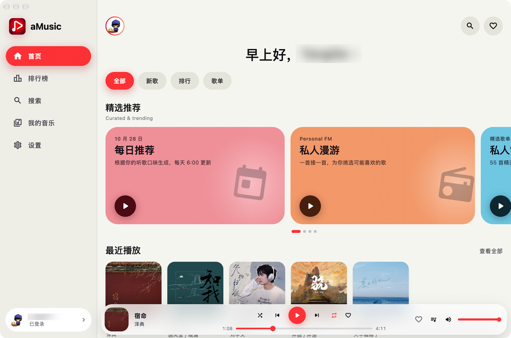
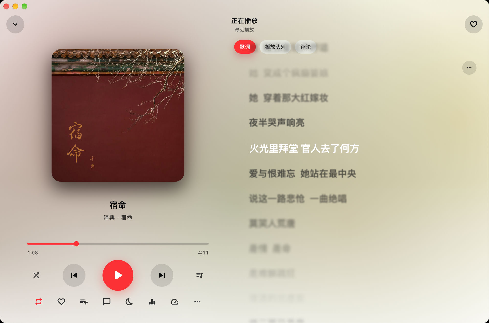

<div align="center">


# aMusic

[](https://github.com/tyuan511/aMusic/releases/latest)
[](https://github.com/tyuan511/aMusic/actions/workflows/release.yml)
[](https://flutter.dev)
[](packages/amusic_engine)

> 第三方网易云音乐客户端。直连官方接口、不经过任何中间服务器；一套 Flutter 代码加一个自研 Rust 播放引擎，覆盖 Android、iOS、macOS、Windows、Linux。

[界面预览](#界面预览) · [功能](#功能) · [架构](#架构) · [播放引擎](#播放引擎) · [快速开始](#快速开始) · [桌面快捷键](#桌面快捷键) · [开发与测试](#开发与测试)

</div>

> [!IMPORTANT]
> aMusic 不是网易云音乐的官方客户端，与网易公司无任何关联。它只是把官方 PC 网页端使用的 eapi / weapi 接口在本地重新实现了一遍：登录、歌单、红心、播放记录都写回你自己的网易云账号。曲库与版权归属网易云，请在登录自己账号的前提下个人使用。

## 界面预览



*首页：轮播推荐、最近播放与常驻播放条*



*正在播放：封面、带景深的歌词面板，以及队列与评论*

## 功能

**发现**

- 首页聚合每日推荐、私人漫游（Personal FM）、精选歌单轮播、新歌速递、新碟上架、官方榜单与最近播放
- 排行榜、搜索（单曲 / 专辑 / 歌手 / 歌单四个维度，带 250ms 防抖联想、搜索历史与分页缓存）
- 歌单 / 专辑 / 艺人详情，热门与最新评论（可点赞、回复、发评论）

**播放**

- 逐字（YRC）卡拉OK歌词，按词填充进度并带长音提亮；支持翻译与音译、点击歌词跳转、字号字重与景深模糊可调
- 歌词选行导出 PNG 分享卡片，移动端直接存相册
- 播放队列拖拽重排、0.5–2.0 倍速（WSOLA 变速不变调）、定时停止（15–90 分钟或播完本首，到时渐弱）
- 在线音质从「标准」到「超清母带」共 8 档，取不到时按降级链自动回退
- 整文件音频缓存 + LRU 淘汰，上限可设（默认 512 MB，可关闭）

**音效**

- 10 段参数均衡器（±12 dB），22 个预设，支持自定义预设保存与实时频响曲线
- 10 种音效：3D 环绕、360° 环绕、LiveHouse 现场由引擎 DSP 生成空间感与混响，其余以频段曲线实现；EQ 与音效互斥

**本地音乐**

- 扫描指定目录或导入单个文件（mp3 / flac / m4a / aac / ogg / wav），读取标签与内嵌封面
- 按 `REPLAYGAIN_TRACK_GAIN` 做音量归一化，同名 `.lrc` 作为本地歌词

**外观与账号**

- 深色 / 浅色 / 跟随系统三套主题；播放页背景由当前封面的主色实时驱动，暂停时自动静止
- 四种登录方式：App 扫码、手机验证码、手机号密码、直接粘贴 Cookie
- 桌面端窗口管理、按屏幕自动缩放（0.8–1.75）、紧凑与宽屏两套布局、全局键盘快捷键
- 应用内自更新：读取 GitHub Releases，可切换 gh-proxy 等加速镜像或自定义前缀，下载后校验 SHA-256

## 架构

```
Flutter / Dart
  lib/ui/         界面 · go_router 五分支 shell + 全屏播放页
  lib/services/   会话 · 歌单库 · 播放器 · 设置 · 本地库 · 更新
  lib/data/       网易云 eapi / weapi 请求与模型解析
        │
        │  dart:ffi —— just_audio 平台后端 + 无状态工具（加密 / 取色 / 探测）
        ▼
Rust 引擎  packages/amusic_engine/rust · ~4.7k 行
  HTTP Range 流 → Symphonia 解码 → EQ → 音效 → 增益 → 限幅 → 重采样
                 → rtrb 无锁环形缓冲 → cpal 输出
```

- **没有中间层**：仓库里没有任何服务端代码。加密、请求、解析全在客户端完成，Cookie 与偏好只存在本机 `SharedPreferences`。
- **不含任何埋点**：依赖树里没有 Sentry / Firebase / 任何分析或崩溃上报 SDK。唯一的「上报」是网易云自己的播放记录（`/feedback/weblog`），并且有独立开关。
- **引擎即插件**：`packages/amusic_engine` 注册为 `just_audio` 的平台后端，五个平台共用同一份 Rust 代码，由各自的构建链（Gradle / CocoaPods / CMake）编译，没有为某个平台单独写一遍播放逻辑。
- **加密下沉到 Rust**：eapi 的 AES-128-ECB 与 weapi 的双重 AES-CBC + RSA 在 `rust/src/crypto.rs` 实现，Dart 侧只负责组装参数。

## 播放引擎

`packages/amusic_engine` 是一个纯 Rust 的实时音频引擎，除播放之外还承担封面取色、标签探测、频谱分析与加密：

| 能力 | 实现 |
| --- | --- |
| 解码 | Symphonia（mp3 / aac / flac / isomp4 / alac / ogg·vorbis / wav / pcm / mkv / adpcm） |
| 网络流 | 可 seek 的 HTTP Range 字节源，配合本地代理边下边播、边播边缓存 |
| 信号链 | 级联 RBJ peaking EQ → 音效 → 软件增益 → 前瞻式砖墙限幅 |
| 音效 DSP | Freeverb 混响、串扰式耳机空间化、8 秒环绕旋转、谐波激励 |
| 变速 | WSOLA，0.5–2.0 倍速保持音高 |
| 输出 | cpal（ALSA / WASAPI / CoreAudio / AAudio 等平台后端），rtrb 无锁环形缓冲，支持 gapless 连播 |
| 附加 | 中位切分封面取色驱动界面强调色、离线 FFT 进度条包络、EBU R128 响度 |

格式探测按文件头嗅探而非扩展名；标签读取覆盖 ID3v1、ID3v2、FLAC / Ogg 的 Vorbis comment，并补读了 Symphonia 会丢掉的 WAV `LIST/INFO`。

## 快速开始

### 下载安装包

到 [GitHub Releases](https://github.com/tyuan511/aMusic/releases/latest) 下载对应平台的产物，应用内也可以直接检查并下载更新。

### 从源码运行

前置条件：

- Flutter stable（Dart SDK `^3.13.0`）
- Rust 工具链 —— 引擎由各平台自己的构建（Gradle / CocoaPods / CMake）调用 `cargo build`，不需要单独编译
- 对应平台原生链：Android SDK + NDK、Xcode、Visual Studio 或 `clang/cmake/ninja` + ALSA 与 GTK 开发包

```bash
git clone https://github.com/tyuan511/aMusic.git
cd aMusic
flutter pub get
flutter run -d macos   # 或 android / ios / windows / linux
```

## 桌面快捷键

只在桌面端生效，字母键不会抢占 <kbd>Cmd</kbd> / <kbd>Ctrl</kbd> / <kbd>Alt</kbd> 组合：

| 按键 | 动作 |
| --- | --- |
| <kbd>Space</kbd> | 播放 / 暂停（媒体键同样有效） |
| <kbd>→</kbd> / <kbd>←</kbd> | 快进 / 快退 5 秒 |
| <kbd>Shift</kbd>+<kbd>→</kbd> / <kbd>←</kbd> | 下一首 / 上一首 |
| <kbd>↑</kbd> / <kbd>↓</kbd> | 音量 ±5% |
| <kbd>L</kbd> / <kbd>Q</kbd> / <kbd>C</kbd> | 打开播放页的歌词 / 队列 / 评论面板 |
| <kbd>M</kbd> / <kbd>F</kbd> / <kbd>Esc</kbd> | 静音 / 全屏 / 关闭播放页 |

## 开发与测试

```bash
flutter test                                    # 33 个测试文件，254 个用例
flutter test integration_test/engine_in_app_test.dart -d macos
cd packages/amusic_engine/rust && cargo test    # 40 个引擎单测
cargo run --release --example bench             # 各 DSP 阶段 CPU 占用
```

`test/flutter_test_config.dart` 会把测试指向宿主平台的引擎动态库，缺失时自动执行 `cargo build --release`；也可用 `AMUSIC_ENGINE_LIB` 指定路径。没有该库或没有音频输出设备时，真机引擎测试会跳过。

## 发布

推送 `v*` tag 触发 `.github/workflows/release.yml`，五个平台并行打包并上传到 GitHub Releases：

| 平台 | 产物 | 说明 |
| --- | --- | --- |
| Android | `app-arm64-v8a-release.apk` | 仅 arm64，使用 debug 签名 |
| macOS | `aMusic-macos.zip` | 未签名未公证，首次运行需手动放行 |
| iOS | `aMusic-ios-unsigned.ipa` | 未签名，需自行重签名后安装 |
| Windows | `aMusic-windows-x64.zip` | release 目录压缩包，非安装器 |
| Linux | `aMusic-linux-x64.tar.gz` | 运行依赖 ALSA 与 GTK |

## 项目结构

```
lib/                       Flutter 应用：UI、服务、网易云接口层
packages/amusic_engine/    Rust 播放引擎、dart:ffi 绑定与各平台构建脚本
android/ ios/ macos/ windows/ linux/
```
